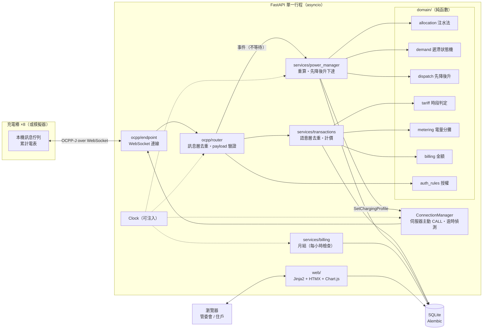
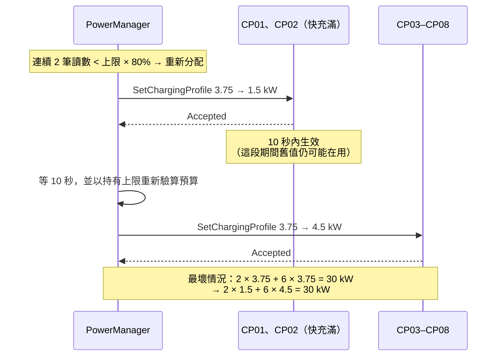
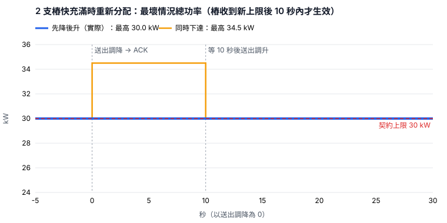
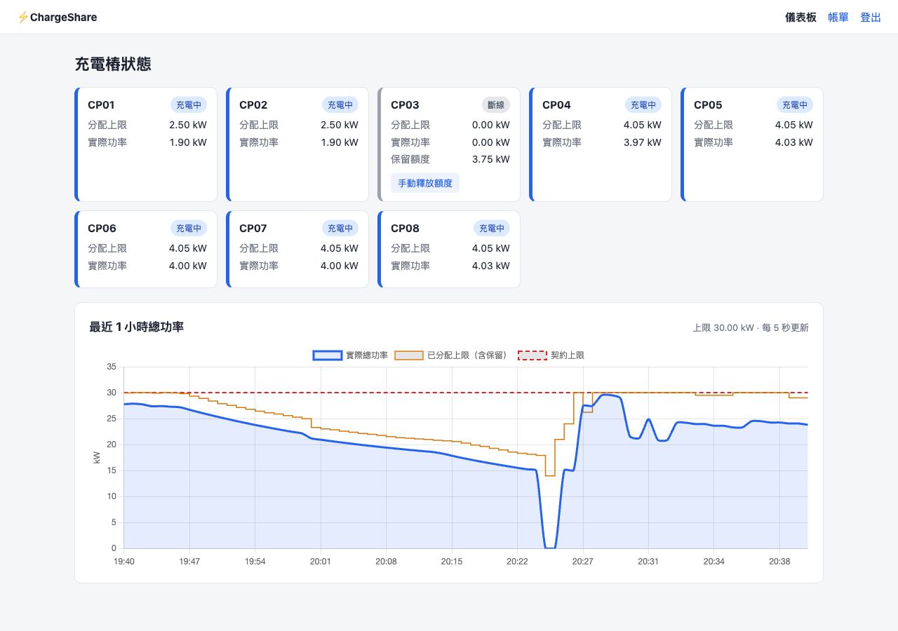
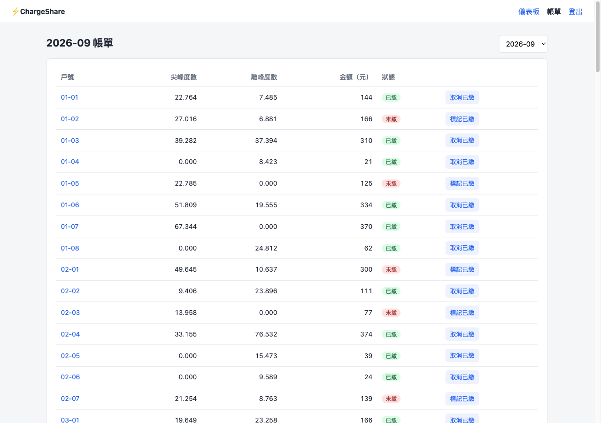
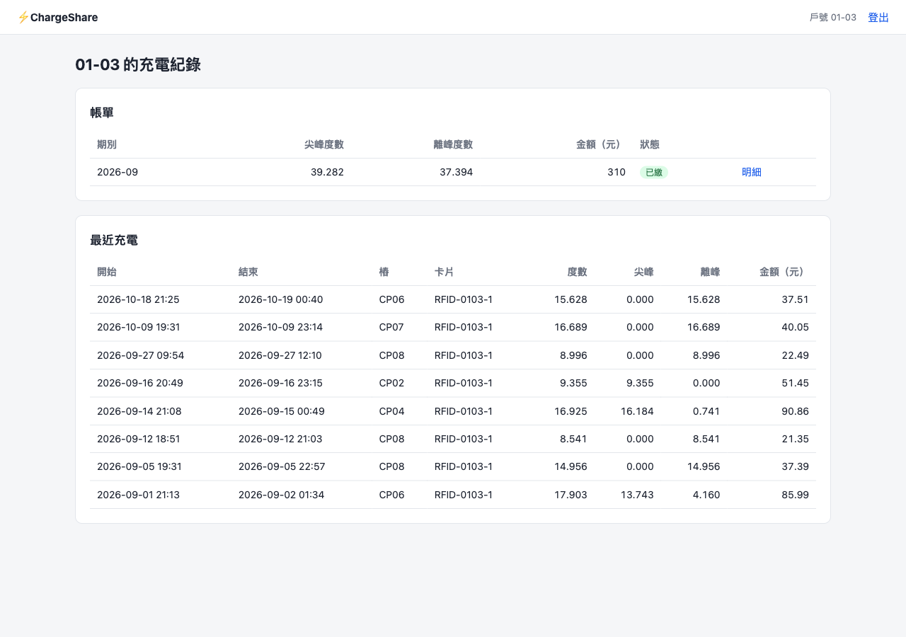
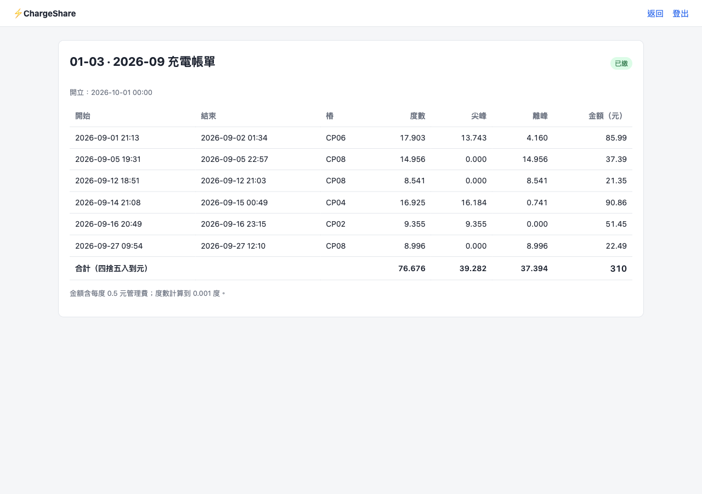

# ChargeShare 社區充電樁共享管理平台

[](https://github.com/hn83320589/ChargeShare/actions/workflows/ci.yml)
[](LICENSE)


一棟 120 戶的社區大樓，地下室有 8 支 7 kW 交流充電樁，但契約容量只撥 30 kW 給充電樁。
ChargeShare 透過簡化版 OCPP 1.6J 控制每支樁的功率上限，確保總功率任何時刻都不超過 30 kW，
並依二段式時間電價向住戶月結收費。充電樁韌體不穩、會斷線或重開機，系統以兩層去重與保守的額度保留處理。

- Python 3.12+、FastAPI（含 WebSocket）、SQLite + SQLAlchemy 2.x + Alembic
- 前端：Jinja2 + HTMX + Chart.js（皆隨專案提供，離線可用）
- 所有時間邏輯透過可注入的 `Clock`（系統時鐘 / 測試用假時鐘 / 加速時鐘）
- 設計文件：[docs/DESIGN.md](docs/DESIGN.md)　測試報告：[docs/TEST_REPORT.md](docs/TEST_REPORT.md)

---

## 快速開始

需要 [uv](https://docs.astral.sh/uv/)。

```bash
uv sync                      # 依 uv.lock 安裝鎖定版本的相依套件
uv run chargeshare serve --dev   # 本機展示：啟動伺服器，首次啟動自動建立範例資料
```

不使用 uv 時，也可以用 pip 安裝（不會使用 `uv.lock` 的鎖定版本；`--group` 需要 pip 25.1 以上）：

```bash
python3 -m venv .venv && source .venv/bin/activate
pip install -e . --group dev     # 只執行伺服器可省略 --group dev
chargeshare serve --dev
```

| 頁面 | 網址 | 範例帳號 |
|---|---|---|
| 管委會儀表板 | http://127.0.0.1:8000/admin | `admin` / `admin`（`--dev`）或你設定的密碼 |
| 住戶登入 | http://127.0.0.1:8000/login | 戶號 `01-01` / 密碼 `pw-01-01`（每戶為 `pw-<戶號>`） |
| 充電樁 WebSocket | `ws://127.0.0.1:8000/ocpp/{charger_id}` | `CP01` … `CP08`，子協定 `ocpp1.6` |

首次啟動會建立 `data/chargeshare.db`，內容為 120 戶（`01-01` … `15-08`）、每戶 1–2 張卡、8 支樁、
**過去 2 個月**的充電紀錄（以實際分配演算法逐分鐘模擬產生）與已結算的月結帳單。

> ⚠️ **`--dev` 只供本機展示**：允許管理員使用公開的預設密碼 `admin`。沒有加 `--dev` 時，
> 必須先設定 `CHARGESHARE_ADMIN_PASSWORD`，否則伺服器拒絕啟動：
>
> ```bash
> CHARGESHARE_ADMIN_PASSWORD='請換成強密碼' uv run chargeshare serve
> ```
>
> Session 金鑰不需要設定：首次啟動會自動產生隨機金鑰，存到資料庫旁的 `data/secret_key`（權限 0600），
> 重啟後沿用。若有多台主機要共用，可改用 `CHARGESHARE_SECRET_KEY` 指定。

範例資料中刻意保留的授權示範：

| 情境 | 卡片 | 結果 |
|---|---|---|
| 正常 | `RFID-0101-1` | Accepted |
| 卡片停用 | `RFID-1408-1` | Blocked |
| 有超過 2 個月未繳帳單（7 月帳單未繳） | `RFID-1507-1`、`RFID-1508-1` | Blocked |

> 「超過 2 個月」需要比 2 個月更早的帳單才能示範，所以這兩戶額外有一筆 7 月的充電紀錄。

### 指令一覽

```bash
uv run chargeshare serve [--dev] [--port 8000] [--db PATH] [--no-seed] [--speed N --start ISO]
uv run chargeshare simulate [--dev] [--scenario all] [--minutes 30] [--speed 60] [--port 8000]
uv run chargeshare sim --url ws://127.0.0.1:8000/ocpp [--scenario …] [--minutes …] [--log …]
uv run chargeshare verify --log sim-logs/latest.jsonl --db data/chargeshare.db
uv run pytest                # 全部測試（約 40 秒，含 3 個端對端模擬）
```

---

## 模擬器

模擬器同時模擬 8 支樁，每支樁有自己的電池模型、本機訊息佇列與電表。

| 情境 `--scenario` | 內容 |
|---|---|
| `normal` | 8 台車每隔 20 秒依序接上，電池容量 `--battery-kwh`（預設 60）、初始電量 `--initial-soc`（預設 0.2） |
| `taper` | CP01、CP02 為 10 kWh 小電池且電量 88%，很快進入降載、功率掉到 1 kW 以下 |
| `disconnect` | CP03 開始充電後第 5 分鐘斷線 10 分鐘，期間持續充電並暫存訊息，重連後依序補送 |
| `reboot` | CP04 開始充電後第 5 分鐘重新開機 60 秒：期間不供電、遺失上限，開機後延續同一筆交易 |
| `meter-reset` | 同 `reboot`，但重開機後**電表從 0 起算**（不穩定韌體的最壞情況） |
| `all` | 以上全部同時發生（預設） |

故障時間從**開始充電**起算，所以不論機器快慢、倍速多高，斷線與重開機都一定發生在充電途中。

**一個指令完成加速模擬與比對**（伺服器與模擬器在同一個行程、共用加速時鐘）：

```bash
uv run chargeshare simulate --dev --minutes 30 --speed 60
# 模擬期間可開 http://127.0.0.1:8000/admin 觀看；結束後輸出：
#   CP04 tx 651：1.890 度（重開機 1 次、斷線 0 次）
#   模擬期間實際總功率峰值：29.69 kW
#   比對完成：8 筆充電的度數與伺服器完全一致
```

**連到另一個行程的伺服器**（真實時間）：

```bash
uv run chargeshare serve --dev                    # 終端機 1
uv run chargeshare sim --minutes 30 --log sim-logs/run.jsonl   # 終端機 2
uv run chargeshare verify --log sim-logs/run.jsonl --db data/chargeshare.db
```

模擬器記錄每筆充電實際送出的讀數依「讀數下降即電表重置」規則累加的電量，以及所有樁「真實瞬間功率」加總的峰值，
`verify` 逐筆比對伺服器計費的尖峰 + 離峰度數。

---

## 系統架構



- **domain/** 只有純函數，不碰資料庫與時鐘，分配與計費的驗收都在這層以單元測試完成。
- 通訊層處理完訊息才**發布事件**給 PowerManager，不在接收迴圈內等待下達結果，避免同一條連線死鎖。
- 單一 asyncio event loop；PowerManager 以單一 worker 串行化重算，過程中的新事件會合併成「之後再算一次」。

---

## WebSocket 訊息格式

連線網址 `ws://host/ocpp/{charger_id}`，子協定 `ocpp1.6`；未登記的樁會被拒絕（close 1008）。
採 OCPP-J 的陣列格式，payload 為簡化版、欄位名稱 camelCase，時間一律為帶時區的 ISO 8601。

```text
CALL        [2, "<messageId>", "<Action>", {payload}]
CALLRESULT  [3, "<messageId>", {payload}]
CALLERROR   [4, "<messageId>", "<errorCode>", "<description>", {}]
```

### 充電樁 → 伺服器

| Action | Request | Response |
|---|---|---|
| `BootNotification` | `{"chargePointVendor":"Acme","chargePointModel":"AC7","firmwareVersion":"0.9"}` | `{"status":"Accepted","currentTime":"…","interval":60}` |
| `Heartbeat` | `{}` | `{"currentTime":"2026-10-22T19:00:00+08:00"}` |
| `StatusNotification` | `{"connectorId":1,"status":"Charging","errorCode":"NoError"}` | `{}` |
| `Authorize` | `{"idTag":"RFID-0101-1"}` | `{"idTagInfo":{"status":"Accepted"}}`（或 `Blocked` / `Invalid`） |
| `StartTransaction` | `{"connectorId":1,"idTag":"RFID-0101-1","meterStart":123456,"timestamp":"2026-10-22T19:00:00+08:00"}` | `{"transactionId":42,"idTagInfo":{"status":"Accepted"}}`；拒絕時 `transactionId` 為 0 |
| `MeterValues` | `{"connectorId":1,"transactionId":42,"timestamp":"2026-10-22T19:01:00+08:00","energyWh":123515,"powerW":3712}` | `{}` |
| `StopTransaction` | `{"transactionId":42,"meterStop":130456,"timestamp":"2026-10-22T21:00:00+08:00","reason":"EVDisconnected"}` | `{}` |

- `energyWh` 為電表**累計值**（Wh），`powerW` 為當下功率（W），每分鐘一筆。
- `status` 可為 `Available`、`Preparing`、`Charging`、`SuspendedEV`、`SuspendedEVSE`、`Finishing`、`Faulted`。
- 錯誤碼：`FormationViolation`（格式錯誤）、`NotImplemented`（不支援的 Action）、
  `PropertyConstraintViolation`（交易不屬於此樁）、`InternalError`。

### 伺服器 → 充電樁

| Action | Request | Response |
|---|---|---|
| `SetChargingProfile` | `{"connectorId":1,"limitW":3750}` | `{"status":"Accepted"}` |

**通訊約定**（模擬器即依此實作）：
1. 樁在收到上限後 10 秒內生效，並依收到順序套用。
2. 樁在收到第一個上限前、以及重開機後，上限為 **0 kW**（不供電）。
3. 斷線期間 `MeterValues`、`StatusNotification`、`StopTransaction` 暫存在本機，重連後以**原 messageId** 依序補送。
4. 重開機前開始的交易，開機後延續同一個 `transactionId`。電表若因重開機歸零，伺服器會依「電表重置」規則處理（見「斷線與補傳」）。

---

## 功率分配演算法

純函數 `domain/allocation.allocate()`，每次重算步驟如下：

1. **保留額度**：有進行中交易但**離線**的樁，保留其「持有上限」。
   持有上限 = max(樁已確認的上限, 已送出未確認的上限)。可用預算 = 30 kW − 保留額度。
2. **決定誰能供電**：線上且有交易的樁依開始時間排序（先來後到），最多 `floor(預算 / 1.4 kW)` 支供電，
   其餘上限 0、狀態「排隊中」。已在供電的樁不會被後到者搶走；有人結束時，排隊第一位自然補上。
   - 22 支同時充電 → `floor(30 / 1.4) = 21` 支各 1.4 kW（共 29.4 kW），第 22 支排隊。
   - 實際只有 8 支樁，8 × 1.4 < 30，所以實務上不會排隊；排隊情境以純函數測試。
3. **注水法（water-filling）**：每支樁有自己的需求上限（一般為 7 kW；快充滿者較低），
   需求低的只拿需求量，省下的由其他樁平分。共同水位一次**向下**取整到 50 W，總和保證 ≤ 預算。
   - 8 支都要電：30 / 8 = **3.75 kW**
   - 2 支快充滿（需求 1.5 kW）：其餘 6 支各 (30 − 3) / 6 = **4.5 kW**，總和 30 kW

### 防止反覆調整

每支樁有一個需求狀態機 `domain/demand.update_demand()`：

```text
         實際功率 < 上限 × 80%，連續 2 筆
 HUNGRY ─────────────────────────────────▶ SATURATED（需求 = 實際功率 + 0.5 kW，以 0.5 kW 級距向上取）
   ▲                                              │
   └────── 實際功率 ≥ min(需求, 上限) × 95% ◀──────┘
```

1. **進入與離開門檻不同**（80% / 95%），在邊界附近不會來回切換。
2. **連續 2 筆**才判定快充滿，單筆雜訊不觸發。
3. SATURATED 時需求**只往下調**，且必須低於目前值一整個 0.5 kW 級距才調整；小幅波動不改變需求。
4. **下達死區**：調升幅度 < 300 W 不送；調降一律送，以確保安全。
5. **只有事件觸發重算**：交易開始/結束、樁上下線、需求狀態改變。功率小幅波動不會觸發。
6. 補傳的舊讀數（早於現在 2 分鐘）只用於計費，不影響需求判定。

### 先降後升：保證「任何時刻」不超過 30 kW

樁收到新上限後最多 10 秒才生效。如果同時對 A 樁調降、B 樁調升，B 先生效而 A 還沒降的那幾秒會超標。所以：

1. 第一階段送出所有**調降**，收到 ACK 後再等 10 秒（透過注入的時鐘）。
2. 第二階段送出**調升**。送出前以所有樁的持有上限重新驗算預算；若第一階段有調降失敗（例如剛好斷線），
   超出預算的調升會延後並排程重試。



下圖是以真正的 PowerManager 跑同一個情境、記錄實際下達的指令，再以「下達後 10 秒內舊值與新值都可能生效，
取較大者」計算每秒的最壞情況總功率。若同時下達調降與調升，最壞情況會到 34.5 kW，超過契約容量
（產生方式：`uv run python scripts/two_phase_chart.py`）。



測試以同樣的方式計算最壞情況的總和，驗證每個時間點 ≤ 30 kW。

---

## 計費與分攤規則

費率在 [config/tariff.toml](config/tariff.toml)，國定假日在 [config/holidays_2026.toml](config/holidays_2026.toml)
（依行政院人事行政總處 115 年辦公日曆表，含補假）。

| | 尖峰 | 離峰 |
|---|---|---|
| 夏月（6/1–9/30） | 週一至週五 09:00–24:00，5.0 元/度 | 其餘 2.0 元/度 |
| 非夏月 | 週一至週五 06:00–11:00、14:00–24:00，4.8 元/度 | 其餘 1.9 元/度 |

週六、週日與國定假日全日離峰；另加收管理費 0.5 元/度。

1. **分攤**：一筆交易的讀數序列為「開始（meterStart）→ 每分鐘讀數 → 結束（meterStop）」。
   相鄰兩點之間的電量依**時間比例線性分攤**到所跨越的時段。斷線或重開機造成的缺口跨過 09:00 或午夜時也能正確切割。
2. **季節與時段依每一段電量所在的時間判定**，不是依充電開始時間。
   例如 5/31（日）22:00 → 6/1（一）08:00 全為離峰，但午夜前以 1.9 元、午夜後以 2.0 元計價。
3. **度數到 0.001 度**：各時段以最大餘數法取整到 Wh，保證「尖峰 + 離峰」恰好等於電表差值。
4. **金額**：每筆交易保留精確金額（Decimal），**帳單總額**加總後四捨五入到元（ROUND_HALF_UP）。
5. 沒有該年度國定假日資料時直接拋錯，不會默默算錯。

**手算範例**（測試 `test_monthly_bill_matches_hand_calculation`）：

| 充電 | 尖峰 | 離峰 | 金額 |
|---|---|---|---|
| 10/23（五）23:00 → 10/24（六）07:00，7 kW | 7 度 × 4.8 = 33.6 | 49 度 × 1.9 = 93.1 | + 56 × 0.5 = **154.70** |
| 10/22（四）10:00 → 12:00，3.5 kW | 3.5 度 × 4.8 = 16.8 | 3.5 度 × 1.9 = 6.65 | + 7 × 0.5 = **26.95** |
| **帳單** | 10.5 度 | 52.5 度 | 181.65 → **182 元** |

### 月結帳單

- 伺服器啟動時與每小時檢查一次；每月 1 日起產生上個月的帳單，每期只結算一次（`billing_runs`）。
- 帳單 P 包含所有「已結束、尚未入帳、且在 P 月底前結束」的交易，**跨月充電歸屬結束時間**所在月份。
- 斷線樁在月結後才補送上月的 `StopTransaction` 時，該筆自動併入下一期，不會遺漏也不會重複。
- 管委會可在「帳單」頁標記或取消已繳。
- 帳單明細上，跨月的充電會標示「跨月」，說明依規定歸入結束月份。
- **授權拒絕**：卡片停用，或該戶有任一張帳單**開立後超過 2 個日曆月**仍未繳（9/1 開立 → 11/2 起拒絕）。

---

## 斷線與補傳

### 兩層去重（同一則訊息重送幾次都只算一次）

1. **訊息層**：`processed_messages(charger_id, message_id)`。已處理過的訊息直接回傳當時快取的回應。
   查詢、處理、寫入快取在**同一個 DB 交易**內完成；處理失敗不會留下「已處理」標記，CALLERROR 也不快取，樁可以重試。
2. **語意層**：防止樁重開機後換了新的 messageId 重送。
   - `MeterValues`：`UNIQUE(transaction_id, ts)`
   - `StartTransaction`：同一支樁同一開始時間 → 回傳原本的 `transactionId`
   - `StopTransaction`：交易已結束 → 回 ACK，不再變更
3. 交易結束後才補到的讀數照樣收下，並**重新計價**，順序錯亂也不會漏算。

### 電表重置（重開機後電表歸零）

不穩定的韌體可能在重開機後讓電表從 0 起算。伺服器的處理方式：

- 同一筆交易中，**讀數下降視為電表重置**：該段電量 = 新讀數本身（從 0 數到新讀數），之後照常累加。
  例如 1,111,213 → 1,111,330 → **4** → 56 → 364 → 停止 400，計費電量 = 117 + 4 + 52 + 308 + 36 = 517 Wh。
- `MeterValues` 與 `StopTransaction` **一律收下，不回錯誤**。若回 CALLERROR，樁會無限重送，交易就永遠無法結束。
- 交易標記為「電表重置，待管委會確認」：管委會儀表板上方會列出這些交易，確認後才消失；帳單明細也會標示「電表重置」。
- 重置前最後一筆讀數到實際歸零之間的電量（最多 1 分鐘，且重開機期間不供電）伺服器無從得知，不計入。

### 斷線時的功率保留

- WebSocket 關閉，或超過 2 倍 heartbeat 間隔（120 秒）沒有任何訊息（處理 TCP 半開），就判定為離線。
- 離線樁從斷線那一刻起即**保留其持有上限**，不分給其他樁，因為它可能仍在依最後收到的上限供電。
  超過 5 分鐘後仍持續保留，直到：
  - 樁重新連線：先處理補送佇列，再重算，並一律重送該樁上限（它可能重開機遺失了上限）；或
  - 管委會確認該樁已停止供電後，在儀表板按「手動釋放額度」。
- 伺服器重啟時，從資料庫還原各樁上限與進行中的交易；所有樁視為離線並保留額度，直到重新連線。

---

## 畫面

**管委會儀表板**：8 支樁的狀態（可用 / 充電中 / 排隊中 / 斷線 / 故障）、分配上限、實際功率、離線保留額度，
以及最近 1 小時總功率曲線（實際功率、已分配上限含保留、30 kW 上限線），每 5 秒更新。



**帳單管理**：



**住戶頁面與帳單明細**：





---

## 測試

```bash
uv run pytest          # 全部
uv run pytest tests/unit tests/integration   # 不含端對端模擬（約 3 秒）
uv run ruff check . && uv run ruff format --check .
```

| 驗收項目 | 測試 |
|---|---|
| 2 停用卡片 / 超過 2 個月未繳被拒 | `tests/unit/test_auth_rules.py`、`tests/integration/test_authorization.py` |
| 3 8 台各 3.75 kW | `test_allocation.py::test_eight_hungry_chargers_share_equally`、`test_power_manager.py::test_eight_sessions_get_equal_share` |
| 4 快充滿釋放額度、不反覆調整 | `test_allocation.py::test_saturated_chargers_release_power_to_others`、`test_demand.py::test_no_repeated_dispatch_under_noise_after_two_cars_taper`、`test_power_manager.py::test_small_power_fluctuation_sends_nothing` |
| 5 22 支只有 21 支供電、依序補上 | `test_allocation.py::test_twenty_two_chargers_only_twenty_one_served`、`::test_queued_chargers_are_promoted_in_arrival_order` |
| 6 週五 23:00 → 週六 07:00 | `test_metering.py::test_friday_night_to_saturday_morning`、`test_billing.py::test_price_friday_night_session` |
| 7 5/31 22:00 → 6/1 08:00 | `test_metering.py::test_crossing_into_summer_switches_rate_at_midnight`、`test_billing.py::test_price_across_seasons_uses_each_season_rate` |
| 8 補傳納入計費、重送 3 次度數不變 | `test_ocpp_flow.py::test_resending_same_meter_message_three_times_is_counted_once`、`::test_buffered_messages_replayed_after_reconnect_are_billed` |
| 9 斷線 5 分鐘後額度保留 | `test_allocation.py::test_offline_charger_keeps_its_reserved_power`、`test_power_manager.py::test_disconnected_charger_keeps_reservation_after_five_minutes` |
| 10 重開機後度數一致 | `tests/e2e/test_simulation.py::test_reboot_mid_charge_keeps_one_session_with_exact_energy` |
| 11 月結帳單與手算一致 | `test_billing_service.py::test_monthly_bill_matches_hand_calculation` |
| 12 曲線不超過 30 kW | `test_power_manager.py`（最壞情況總和）、`test_seed.py`、`test_fleet_of_eight_for_thirty_minutes`（真實瞬間功率峰值） |
| 13 8 支樁 30 分鐘 | `tests/e2e/test_simulation.py::test_fleet_of_eight_for_thirty_minutes` |
| 14 ≥ 35 個測試 | `uv run pytest` |

---

## 已知限制

- **離線時無法開始充電**：`Authorize` 需要伺服器在線，所以樁的本機佇列只會有
  `MeterValues`、`StatusNotification`、`StopTransaction`。
- **計費以樁的時間戳為準**，不處理樁時鐘偏移；時間戳超出交易區間的讀數會被忽略。
- **電表重置時**，重置前最後一筆讀數到歸零之間的電量（最多 1 分鐘）無法計入；這類交易會標記給管委會確認。
- **永久故障的離線樁會一直保留額度**，需要管委會確認後手動釋放。
- **「排隊中」只能用純函數測試**：實體只有 8 支樁，8 × 1.4 kW < 30 kW，正常不會排隊；
  僅在多支樁離線保留大量額度時才可能出現。
- **需求偵測依每分鐘的讀數**，快充滿釋放額度最快約需 2 分鐘。
- **單一行程、單一 SQLite**：PowerManager 的狀態在記憶體中（重啟時從 DB 還原），不支援多個伺服器實例。
- 簡化版 OCPP：每支樁只有一個 connector；`SetChargingProfile` 只有功率上限，沒有排程。
- 國定假日資料目前只有 2026 年，跨年後需新增 `config/holidays_2027.toml`（缺少時會明確報錯）。
- 住戶登入只有戶號 + 密碼，沒有註冊、忘記密碼與登入失敗次數限制。

---

## 專案結構

```text
config/                 tariff.toml、holidays_2026.toml
docs/                   DESIGN.md、TEST_REPORT.md、screenshots/、images/
scripts/                two_phase_chart.py（產生「先降後升」對照圖）
src/chargeshare/
  clock.py              Clock 介面與 System / Fake / Scaled 實作
  domain/               allocation、demand、dispatch、tariff、metering、billing、auth_rules（純函數）
  db/                   models、types（TZDateTime / DecimalText）、migrations/
  ocpp/                 protocol、messages、router、connections、endpoint
  services/             transactions、power_manager、billing、authorization、events
  web/                  routes、views、templates/、static/
  simulator/            charge_point、ev、scenarios、fleet、recorder
  seed.py  runner.py  cli.py  app.py  settings.py
tests/{unit,integration,e2e}/
```

---

## 授權

[MIT License](LICENSE)
