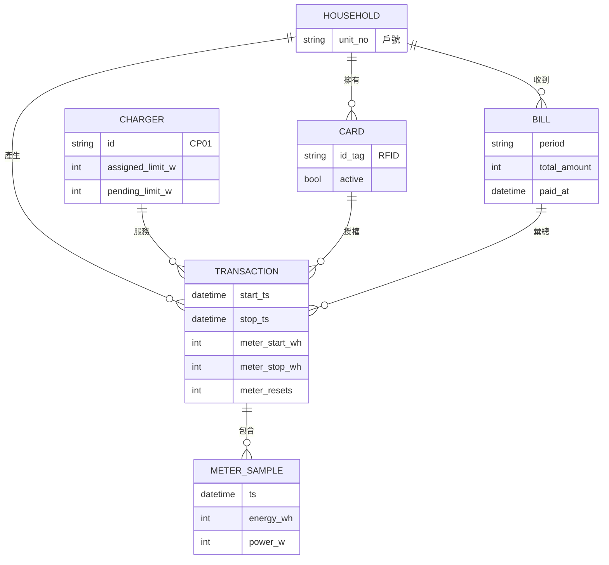
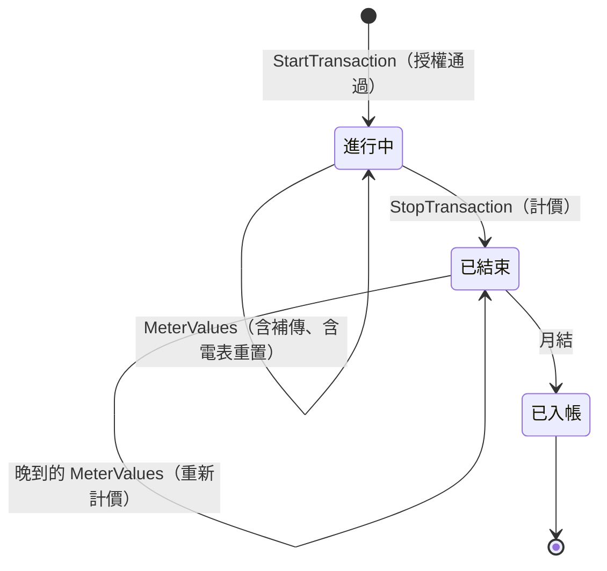
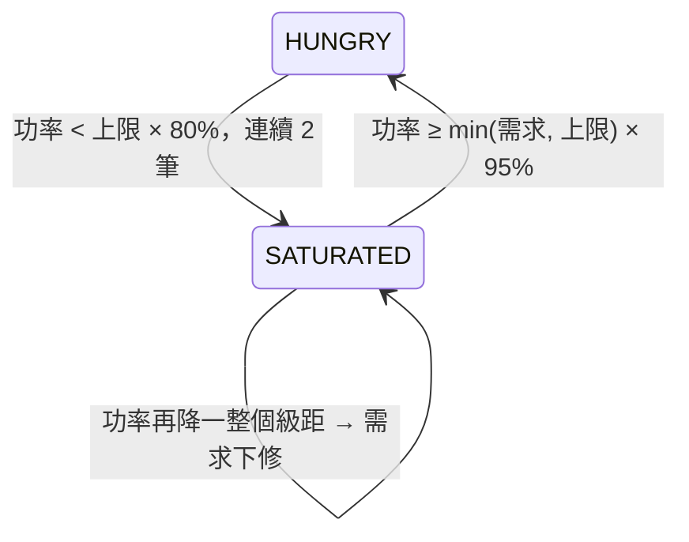
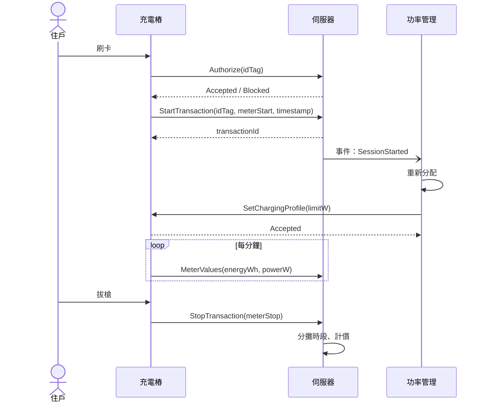
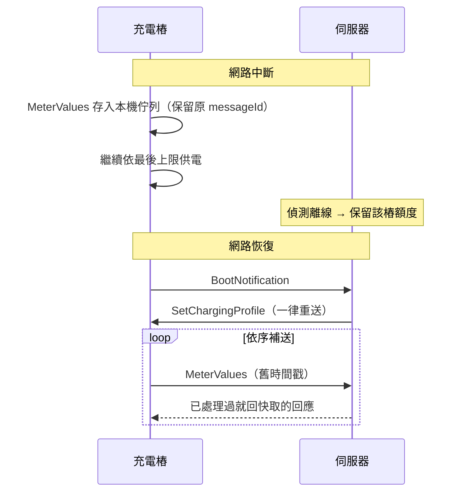
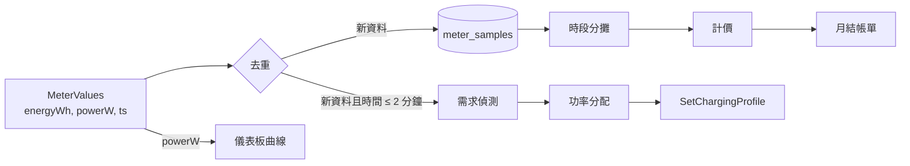

# 第 2 章　系統分析：領域模型、狀態與失效

## 學習目標

- 從需求中萃取**領域模型**（實體、關係、值物件）
- 用**狀態機**描述會隨時間變化的東西
- 用**使用案例**與**循序圖**描述系統行為
- 用**失效模式分析**（FMEA）系統性地找出「會壞在哪裡」

---

## 2.1 參與者（Actors）

先問：誰會跟這個系統互動？

| 參與者 | 互動方式 | 主要目的 |
|---|---|---|
| 充電樁 | WebSocket（OCPP） | 回報狀態與電表、接收功率上限 |
| 住戶 | 網頁 | 查看自己的充電紀錄與帳單 |
| 管委會 | 網頁 | 監看樁的狀態與總功率、管理帳單、處理異常 |
| 時間（排程器） | 系統內部 | 每月 1 日產生帳單、定時記錄功率曲線 |

> 💡 **教學重點**：把「時間」當成一個參與者，是分析排程類需求的好技巧。
> 「每月 1 日產生帳單」本質上就是「時間」觸發了一個使用案例。

---

## 2.2 領域模型

從需求中把名詞挑出來，判斷哪些是需要儲存、有身分的**實體**，哪些只是描述性的**值**：



**值物件**（沒有身分、只描述某個量）在程式中用 `frozen dataclass` 表示，例如：

| 值物件 | 意義 | 位置 |
|---|---|---|
| `RatePeriod(season, band)` | 「夏月尖峰」這種時段 | `domain/tariff.py` |
| `Reading(ts, energy_wh)` | 某時刻的電表讀數 | `domain/metering.py` |
| `Charge(peak_wh, offpeak_wh, …)` | 一筆充電的計價結果 | `domain/billing.py` |
| `Allocation(limits, queued, reserved)` | 一次分配的結果 | `domain/allocation.py` |

### 一個容易忽略的關鍵屬性

`CHARGER` 有兩個上限欄位：`assigned_limit_w`（樁已確認）與 `pending_limit_w`（已送出、未確認）。
為什麼需要兩個？因為送出指令到收到確認之間，**我們不知道樁正在用哪一個值**。
這個不確定性是整個安全設計的核心，第 7 章會詳細說明。

> 💡 **教學重點**：領域模型裡最有價值的屬性，往往是用來表達「不確定」或「進行中」的狀態。
> 只建「確定的事實」的模型，在分散式環境下一定會出錯。

---

## 2.3 狀態機

會隨時間變化、而且變化有規則的東西，就該畫成狀態機。本系統有三個。

### (1) 交易（一次充電）



注意「已結束 → 已結束」這條自我轉移：交易結束後才補到的讀數**還是要收**，並重新計價。
如果狀態機沒有畫這條邊，實作時就會把它當錯誤丟掉——然後少收錢。

### (2) 樁的顯示狀態

題目要求 5 種顯示狀態。它不是直接存的欄位，而是由多個事實**推導**出來的：

```python
# src/chargeshare/web/views.py（排版精簡，省略型別標註）
def display_status(online, ocpp_status, has_session, queued) -> str:
    if not online:                 return "斷線"
    if ocpp_status == "Faulted":   return "故障"
    if has_session:                return "排隊中" if queued else "充電中"
    return "可用"
```

判斷的**順序**就是優先權：斷線最優先（伺服器根本不知道它現在怎樣），故障其次。

> 💡 **教學重點**：能推導的就不要存。存了兩份事實，就要擔心它們不一致。

### (3) 需求偵測（快充滿與否）



這是一個**遲滯**（hysteresis）狀態機，進入與離開的門檻不同，目的是防止來回震盪。
第 7 章會說明為什麼門檻是 80% / 95%、為什麼要「連續 2 筆」。

---

## 2.4 使用案例與循序圖

### 使用案例：住戶刷卡充電



注意 `S-)PM` 用的是**非同步箭頭**：伺服器只發出事件、不等功率管理處理完就回覆樁。
這是刻意的設計（第 8 章「死鎖預防」）。

### 使用案例：斷線與補傳



---

## 2.5 失效模式分析（FMEA）

系統分析最常被跳過、卻最有價值的一步：**系統性地列出每個元件會怎麼壞**，以及後果與對策。

| 元件 | 失效模式 | 後果 | 對策 | 章節 |
|---|---|---|---|---|
| 網路 | 樁斷線 | 伺服器不知道它還在供電 | 從斷線起保留其額度 | 7 |
| 網路 | TCP 半開（沒收到關閉通知） | 永遠以為它在線 | 2 倍 heartbeat 無訊息即判離線 | 6 |
| 網路 | 回應遺失，樁重送 | 重複計費 | 訊息層去重（messageId） | 6 |
| 樁韌體 | 重開機後換新 messageId 重送 | 訊息層去重失效 | 語意層去重（交易 + 時間戳） | 6 |
| 樁韌體 | 重開機後忘記上限 | 可能以預設值供電 | 約定預設 0 kW；重連一律重送 | 6 |
| 樁韌體 | 電表歸零 | 讀數倒退 | 視為重置、分段累加、標記確認 | 6 |
| 樁韌體 | 套用上限需要時間 | 過渡期超標 | 先降後升 | 7 |
| 下達指令 | 調降送出但未確認 | 不知道樁在用哪個值 | 以 max(已確認, 未確認) 計算 | 7 |
| 伺服器 | 重啟 | 記憶體狀態遺失 | 上限與交易持久化，啟動時還原 | 7 |
| 時間 | 樁時鐘偏移 | 時段判定錯 | 已知限制（記錄在 README） | — |
| 管理員 | 誤釋放仍在供電的樁 | 超過 30 kW | 需確認對話框；嚴格的身分驗證 | 10 |

> 💡 **教學重點**：FMEA 的價值是**強迫你看完每一格**。
> 本專案在審查時被找到的電表歸零問題（第 10 章案例 7），就是當初這張表漏掉的一列——
> 「讀數倒退」被當成資料錯誤，而不是一種可預期的失效模式。

---

## 2.6 資料流

最後用資料流確認每筆資料的來源與去向，避免「資料有進來卻沒人用」或「需要的資料沒有來源」：



同一筆 `MeterValues` 分成兩條路：`energyWh` 走**計費**（全部都要、不管多舊），
`powerW` 走**控制**（只要新的）。這就是第 1 章隱含需求 (3) 在資料流上的樣子。

---

## 小結

1. 參與者包括「時間」。
2. 領域模型要能表達「不確定」的狀態（已送出但未確認）。
3. 能推導的狀態不要另外存。
4. 狀態機要把所有轉移畫完，包括自我轉移。
5. FMEA 逐格檢查每種失效，漏掉的一格就是未來的 bug。

## 思考題

1. 如果一張卡可以同時在兩支樁使用，領域模型要怎麼改？授權規則呢？
2. 在交易狀態機中加入「暫停（車主遠端暫停）」狀態，需要哪些新的轉移？
3. 為 FMEA 表再加 3 列：資料庫寫入失敗、時鐘倒退、管委會同時在兩個瀏覽器操作。
