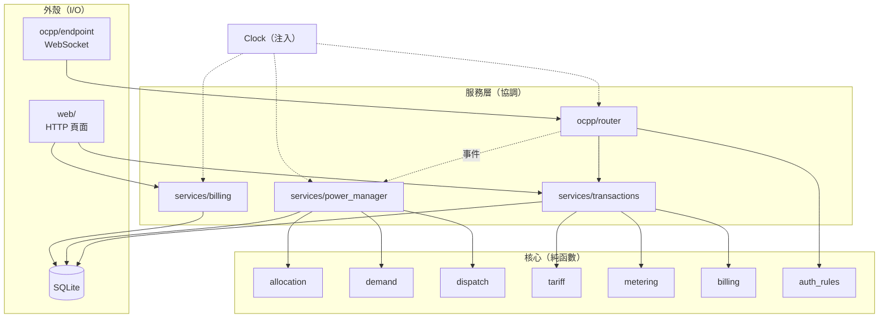

# 第 3 章　架構設計：純函數核心、薄薄的外殼

## 學習目標

- 理解「**函數式核心、命令式外殼**」（Functional Core, Imperative Shell）的分層方式
- 用**事件**解耦通訊層與控制層
- 用**依賴注入**讓時間、連線、資料庫都能在測試中替換
- 學會寫**架構決策紀錄**（ADR）

---

## 3.1 全貌



三層的規則：

| 層 | 可以做 | 不可以做 |
|---|---|---|
| **核心**（`domain/`） | 計算 | 讀寫資料庫、讀時鐘、網路、log |
| **服務**（`services/`、`ocpp/router`） | 呼叫核心、讀寫資料庫、讀注入的時鐘 | 直接碰 WebSocket 或 HTTP |
| **外殼**（`ocpp/endpoint`、`web/`） | 收發網路訊息、轉換格式 | 業務規則 |

依賴方向一律**由外往內**：外殼依賴服務，服務依賴核心，核心不依賴任何人。

---

## 3.2 為什麼要純函數核心？

看分配演算法的簽章：

```python
# src/chargeshare/domain/allocation.py
def allocate(chargers: Iterable[ChargerInput], config: PowerConfig) -> Allocation:
```

輸入是一串樁的狀態，輸出是分配結果。沒有資料庫、沒有時鐘、沒有網路。這帶來三個好處：

1. **好測試**：驗收 5 要測 22 支樁（實體只有 8 支），純函數直接餵 22 筆資料就好。
   甚至可以隨機產生 2,000 組輸入檢查不變量（第 9 章）。
2. **好推理**：要理解分配邏輯，只要讀這一個檔案，不用追資料庫或時序。
3. **可重用**：範例資料產生器（`seed.py`）直接呼叫同一個 `allocate()` 模擬 2 個月，
   產生的歷史資料自然符合 30 kW 限制——同一份邏輯，兩種用途。

反例：如果把分配邏輯寫在 `PowerManager` 裡、直接讀資料庫，測 22 支樁就得先建 22 支樁的資料、
啟動事件迴圈、模擬 WebSocket……測試會慢 100 倍，而且很難寫。

> 💡 **教學重點**：判斷一段邏輯該不該是純函數，問一句：「這段邏輯本身需要知道現在幾點、資料存在哪嗎？」
> 分配演算法只需要「每支樁的狀態」，所以它應該是純函數；**取得**這些狀態是服務層的事。

---

## 3.3 服務層：協調者

服務層把核心的純函數接到真實世界。以 `PowerManager` 為例（`services/power_manager.py`），它負責：

1. 接收事件、維護每支樁的記憶體狀態
2. 呼叫 `update_demand()`、`allocate()`、`plan_dispatch()` 三個純函數
3. 依計畫下達指令、處理失敗、重試
4. 把上限寫入資料庫，以便重啟後還原

```python
async def _rebalance(self) -> None:
    self._allocation = allocate(self._inputs(), self._power)          # 純函數
    ...
    plan = plan_dispatch(current, target, self._deadband_w)           # 純函數
    ...
    if decreases:
        results = await asyncio.gather(*(self._send(c, w) for c, w in decreases.items()))
        if any(results):
            await self._clock.sleep(self._settle_s)                   # 注入的時鐘
    if increases:
        await self._send_increases(increases)
```

讀起來像一份「流程說明」，複雜的計算都委派給核心。

---

## 3.4 事件：解耦通訊與控制

通訊層（router）處理完一則訊息後，**發布事件**給功率管理，而不是直接呼叫它：

```python
# src/chargeshare/services/events.py
@dataclass(frozen=True)
class SessionStarted:
    charger_id: str
    transaction_id: int
    started_at: datetime

class EventSink(Protocol):
    def publish(self, event: Event) -> None: ...
```

為什麼不直接呼叫 `power_manager.rebalance()`？

1. **避免死鎖**：重新分配會對樁送出 `SetChargingProfile` 並等待回覆。
   如果在處理該樁訊息的過程中同步等待，回覆也要從同一條連線進來，但接收迴圈正被佔用 → 死鎖。
   發布事件是同步、立即返回的；功率管理另開 task 處理（第 8 章）。
2. **commit 之後才發布**：router 在資料庫交易 commit 後才發布事件，訂閱者不會讀到還沒寫入的資料。
3. **可單獨測試**：測試 PowerManager 時直接 `publish()` 假事件即可，不需要啟動 WebSocket
   （`tests/integration/test_power_manager.py` 全部都是這樣寫的）。

```python
# src/chargeshare/ocpp/router.py（節錄）
with self._session_factory.begin() as session:
    ...
    response = handler(ctx, request)       # handler 只把事件放進 ctx.events
    ...
# 交易 commit 後才發布事件，避免訂閱者讀到未寫入的資料
for event in ctx.events:
    self._events.publish(event)
```

---

## 3.5 依賴注入：把「世界」變成參數

系統裡有三樣東西在測試時必須替換：

| 依賴 | 介面 | 正式實作 | 測試替身 |
|---|---|---|---|
| 時間 | `Clock` | `SystemClock` | `FakeClock`（手動推進）、`ScaledClock`（加速） |
| 樁的連線 | `ChargerLink` | `ConnectionManager` | `FakeLink`（記錄下達了什麼） |
| 資料庫 | `sessionmaker` | 檔案 SQLite | 暫存目錄的 SQLite |

介面用 `typing.Protocol` 定義（結構化型別），測試替身不需要繼承任何東西：

```python
# src/chargeshare/services/power_manager.py
class ChargerLink(Protocol):
    def is_online(self, charger_id: str) -> bool: ...
    async def call(self, charger_id: str, action: str,
                   payload: dict[str, Any], timeout_s: float = 30) -> dict[str, Any]: ...
```

整個應用程式由一個工廠函數組裝：

```python
# src/chargeshare/app.py
def create_app(settings: Settings, clock: Clock) -> FastAPI:
```

正式啟動傳入 `SystemClock()`；端對端測試傳入 `ScaledClock(speed=120)`，
讓伺服器和模擬器共用同一個加速時鐘，30 分鐘的情境 15 秒跑完。

> 💡 **教學重點**：題目的限制「時間相關邏輯一律透過可注入的時鐘取得」看起來只是測試方便，
> 實際上它讓「加速模擬」「重現某個時間點的 bug」「端對端測試」全都變得可能。

---

## 3.6 為什麼是單一行程？

可以拆成「通訊服務」「功率服務」「計費服務」三個微服務嗎？技術上可以，但不應該：

| 考量 | 單一行程 | 微服務 |
|---|---|---|
| 規模 | 8 支樁、120 戶，一台小主機綽綽有餘 | 過度設計 |
| 一致性 | 功率分配需要全域一致的狀態，單一行程內一把鎖就夠 | 需要分散式鎖或共識 |
| 部署 | 一個指令（題目要求） | 需要協調多個服務 |
| 測試 | 端對端測試在一個 event loop 內完成 | 需要容器編排 |

這個決定記錄在 README 的「已知限制」：不支援多個伺服器實例。**清楚寫下限制**比假裝能擴展更專業。

---

## 3.7 架構決策紀錄（ADR）

重要的決定要寫下「當時的情境、選了什麼、為什麼、代價是什麼」。以本專案的一個決策為例：

> **ADR：功率分配邏輯為純函數**
>
> - **情境**：驗收 5 要求以純函數測試分配演算法；分配邏輯是系統最關鍵的部分，需要大量測試。
> - **決定**：`allocate()` 只接收樁的狀態快照，回傳分配結果；狀態收集與指令下達由 `PowerManager` 負責。
> - **理由**：可用大量隨機輸入驗證不變量；範例資料產生器可重用同一份邏輯。
> - **代價**：`PowerManager` 需要把記憶體狀態轉成 `ChargerInput`，多一層轉換。

本專案的決策表在 [DESIGN.md §9](../DESIGN.md)，共 11 項，包括審查後新增的兩項。

---

## 3.8 目錄結構就是架構

```text
src/chargeshare/
  clock.py          ← 時間抽象
  domain/           ← 核心：純函數，可單獨測試
  db/               ← 資料表、型別、migration
  ocpp/             ← 通訊外殼：protocol（格式）、router（分派）、connections、endpoint
  services/         ← 協調者：transactions、power_manager、billing、authorization、events
  web/              ← 網頁外殼
  simulator/        ← 獨立的模擬器（只依賴 clock 與 seed 的命名規則）
  app.py            ← 組裝
  cli.py            ← 指令列入口
```

打開目錄就能看出分層。新成員要找「分配演算法」，不用問人就知道去 `domain/`。

---

## 小結

1. 核心只做計算，外殼只做 I/O，服務層負責協調。
2. 依賴方向由外往內。
3. 用事件解耦，並在 commit 後才發布。
4. 時間、連線、資料庫都透過注入取得。
5. 選擇最簡單的部署形態，並把限制寫清楚。

## 思考題

1. `PowerManager` 目前把狀態放在記憶體。如果要支援兩台伺服器互為備援，你會怎麼改？代價是什麼？
2. 計費的 `price()` 是純函數，但它需要 `Tariff`（費率設定）。設定檔是 I/O，為什麼這樣仍算純函數？
3. 試著為「先降後升」寫一份 ADR。
