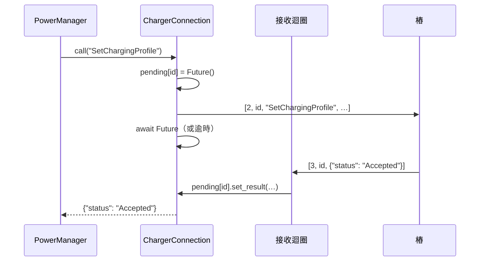

# 第 6 章　通訊協定與可靠性：和不可靠的硬體打交道

## 學習目標

- 理解 OCPP-J 的訊息框架與「請求—回應」對應方式
- 實作**兩層去重**，讓重送不會重複計算
- 掌握「去重紀錄與業務處理必須在同一個交易內」的原則
- 處理斷線、TCP 半開、補傳、重開機、電表歸零
- 判斷什麼時候該回錯誤、什麼時候該「收下並標記」

---

## 6.1 OCPP-J 訊息框架

OCPP 1.6J 在 WebSocket 上傳 JSON 陣列，第一個元素表示訊息類型：

```text
CALL        [2, "<messageId>", "<Action>", {payload}]
CALLRESULT  [3, "<messageId>", {payload}]
CALLERROR   [4, "<messageId>", "<errorCode>", "<description>", {}]
```

雙方都可以發起 CALL：樁送 `MeterValues` 給伺服器，伺服器送 `SetChargingProfile` 給樁。
回應靠 `messageId` 對應，所以**同一條連線上可以有多個請求交錯**。

解析時用 Python 的 `match` 一次處理類型與長度（[`ocpp/protocol.py`](../../src/chargeshare/ocpp/protocol.py)）：

```python
match kind, len(data):
    case 2, 4 if isinstance(data[2], str) and isinstance(data[3], dict):
        return Call(message_id, data[2], data[3])
    case 3, 3 if isinstance(data[2], dict):
        return CallResult(message_id, data[2])
    case 4, 5:
        return CallError(message_id, str(data[2]), str(data[3]), data[4] or {})
    case 2 | 3 | 4, _:
        raise OcppError("FormationViolation", f"malformed frame: {text[:100]}", message_id)
raise OcppError("ProtocolError", f"unknown message type {kind!r}", message_id)
```

payload 用 pydantic 驗證，欄位名稱自動轉 camelCase，時間型別用 `AwareDatetime`（拒絕沒有時區的時間）：

```python
class MeterValuesRequest(OcppModel):
    connector_id: int = 1
    transaction_id: int
    timestamp: AwareDatetime
    energy_wh: int = Field(ge=0)  # 電表累計值
    power_w: int = Field(ge=0)    # 當下功率
```

---

## 6.2 伺服器主動呼叫：用 Future 對應回應

伺服器送出 `SetChargingProfile` 後要等樁回覆。做法是在送出前登記一個 `Future`，
接收迴圈收到同 `messageId` 的 CALLRESULT 時把結果填進去：



逾時也走注入的時鐘：同時等待 Future 與 `clock.sleep(timeout)`，看誰先完成。
（這段程式在 CI 上還抓到一個隱藏的競態，見第 10 章案例 8。）

---

## 6.3 兩層去重

樁沒收到回應時會重送。重送有兩種樣子，所以要兩層防護：

| 層 | 鍵 | 擋住什麼 |
|---|---|---|
| 訊息層 | `(charger_id, messageId)` | 同一則訊息原封不動重送 |
| 語意層 | 業務上的自然鍵 | 內容相同但 messageId 不同（例如樁重開機後重新產生 ID） |

### 訊息層：快取回應

已處理過的訊息直接回傳**當時的回應**，不再執行。為什麼要回傳原本的回應，而不是回一個「已處理」？
因為 `StartTransaction` 的回應裡有 `transactionId`，樁需要拿到**同一個** ID。

### 關鍵原則：去重紀錄與處理在同一個交易內

```python
# src/chargeshare/ocpp/router.py（節錄）
with self._session_factory.begin() as session:          # 一個資料庫交易
    if dedupe:
        cached = session.get(ProcessedMessage, (charger_id, call.message_id))
        if cached is not None:
            return json.loads(cached.response_json)     # 已處理 → 回快取
    response = handler(ctx, request)                    # 業務處理
    if dedupe:
        session.add(ProcessedMessage(..., response_json=json.dumps(response)))
# with 區塊結束才 commit：處理結果與「已處理」標記一起生效，或一起不生效
```

如果分成兩個交易會怎樣？

| 寫入順序 | 中間當機的後果 |
|---|---|
| 先記「已處理」、再處理 | 標記了但沒處理 → 重送被擋掉 → **少算電** |
| 先處理、再記「已處理」 | 處理了但沒標記 → 重送再處理一次 → **多算電**（語意層會擋住，但不該依賴它） |
| **同一個交易** | 兩者一起成功或一起失敗 ✅ |

### 錯誤不快取

handler 拋出 `OcppError` 時，交易回滾，不會留下「已處理」標記。樁重送時會重新執行——
這讓暫時性的錯誤有機會在重試時成功。

### 語意層

```python
# src/chargeshare/services/transactions.py（節錄）
duplicate = session.scalar(
    select(MeterSample.id).where(MeterSample.transaction_id == tx.id, MeterSample.ts == ts)
)
if duplicate is not None:
    return None
```

再加上資料庫的 `UNIQUE(transaction_id, ts)` 當最後防線（第 5 章）。

> 💡 **教學重點**：冪等的本質是「找出這個操作的**自然鍵**」。讀數的自然鍵是「哪筆交易 × 哪個時間點」，
> 跟它是用哪個 messageId 送來的無關。

---

## 6.4 斷線偵測：TCP 半開

WebSocket 關閉時伺服器會收到通知——**通常**會。但如果樁是突然斷電、或中間的路由器掉了，
TCP 連線可能處於「半開」狀態：伺服器以為連線還在，實際上對方早就不在了。

解法是應用層的心跳逾時：超過 2 倍 heartbeat 間隔（120 秒）沒收到任何訊息，就主動關閉。

```python
async def close_stale(self, timeout_s: float) -> None:
    """關閉超過 timeout_s 沒有任何訊息的連線（TCP 半開時不會收到關閉通知）。

    只關閉 socket；離線標記與事件由 endpoint 的接收迴圈結束時統一處理。
    """
```

注意 docstring 的第二段——這是一個 bug 修正後留下的說明（第 10 章案例 2）：
如果這裡自己把連線移出清單，接收迴圈結束時就會以為「已經處理過」，而不標記離線、不發布事件。
**讓一件事只有一個地方負責**，是避免這類 bug 的通則。

---

## 6.5 補傳：時間戳的兩種用途

斷線期間，樁把 `MeterValues` 和 `StopTransaction` 存在本機佇列，重連後**依序、以原 messageId** 補送。
伺服器收到的是時間戳在 10 分鐘前的讀數：

- **計費**：全部收下，用樁的時間戳分攤到時段（電就是那時候用的）。
- **功率控制**：時間戳早於現在 2 分鐘的讀數**不進入需求偵測**。

```python
def _on_sample(self, charger_id: str, ts: datetime, power_w: int) -> None:
    if ts < self._clock.now() - self._stale_after:
        return  # 補傳的舊資料只用於計費
```

否則 10 分鐘前「快充滿」的讀數會讓系統以為它現在快充滿，把額度挪走。

### 交易結束後才補到的讀數

如果 `StopTransaction` 先到、某筆讀數晚到（例如順序錯亂），那筆讀數**仍然要收**，並且重新計價：

```python
if not tx.is_active:
    # 結束後才補到的讀數：重新分攤時段
    _apply_charge(tx, tariff)
```

測試 `test_late_sample_after_stop_reprices_transaction` 驗證：只有頭尾兩筆讀數時，22:00–01:00 的 21 度
線性分攤為尖峰 14 度；補上 24:00 那筆（18 度）後，正確結果變成尖峰 18 度、離峰 3 度。

---

## 6.6 重開機：遺失的上限

樁重開機後可能忘記伺服器下達的上限。我們在通訊約定中規定「沒收到上限前為 0 kW」，
並在樁每次連線時**一律重送**它的上限：

```python
case ChargerConnected(charger_id) | ChargerBooted(charger_id):
    # 樁可能重開機而遺失上限，重新連線後一律重送
    self._force_send.add(charger_id)
    self._kick()
```

即使上限值沒變也送。多送一次的成本很低，少送一次可能讓樁不供電（或更糟，用韌體預設值供電）。

---

## 6.7 電表歸零：什麼時候「不該」回錯誤

這是本專案在程式碼審查中被找到的最嚴重問題（第 10 章案例 7）。

原本的設計把「讀數倒退」當成資料錯誤，`StopTransaction` 回 CALLERROR。看起來是 fail fast，但結果是：

1. CALLERROR 不會被快取（6.3 節），樁會**重送**。
2. 每次重送都得到同樣的錯誤。
3. 交易永遠停在「進行中」，度數與金額都是空的。

問題在於：**對通訊協定來說，回錯誤等於要求對方重試**。如果錯誤不會因為重試而消失，就變成無限迴圈。

修正後的原則：

| 狀況 | 重試會好嗎？ | 處理方式 |
|---|---|---|
| JSON 格式錯誤、欄位缺漏 | 不會，但這是樁的 bug | 回 CALLERROR，讓問題浮現 |
| 交易 ID 不屬於這支樁 | 不會 | 回 CALLERROR |
| **讀數倒退（電表重置）** | 不會，而且是**可預期的現場狀況** | **收下、照規則計費、標記人工確認** |

電表重置的計費規則：同一筆交易中讀數下降時，該段電量就是新讀數本身（電表從 0 數到新讀數）：

```python
def segment_energy(prev: Reading, cur: Reading) -> int:
    if cur.energy_wh >= prev.energy_wh:
        return cur.energy_wh - prev.energy_wh
    return cur.energy_wh
```

例：1,111,213 → 1,111,330 → **4** → 56 → 364 → 停止 400，電量 = 117 + 4 + 52 + 308 + 36 = 517 Wh。

> 💡 **教學重點**：fail fast 的意思是「錯誤要盡早被看見」，不是「一有異常就拒絕」。
> 面對外部系統時要分清楚：這是**對方的錯**（拒絕，讓它浮現），還是**世界本來就會這樣**（接受、記錄、交給人判斷）。

---

## 小結

1. 用 messageId 與 Future 對應非同步的請求與回應。
2. 兩層去重：訊息層擋原封重送，語意層擋換 ID 重送。
3. 去重紀錄與業務處理在同一個交易內。
4. 用應用層心跳偵測半開連線；一件事只讓一個地方負責。
5. 同一筆資料，計費用全部、控制只用新的。
6. 回錯誤等於要求重試；可預期的異常應該收下並標記。

## 思考題

1. 如果樁補傳的順序錯亂（先送第 5 分鐘、再送第 3 分鐘），系統的計費結果會正確嗎？需求偵測呢？
2. `processed_messages` 只快取成功的回應。如果某則訊息處理時資料庫剛好鎖住、回了 InternalError，接下來會發生什麼？
3. 設計一個情境：樁的時鐘比伺服器快 10 分鐘。哪些功能會受影響？
