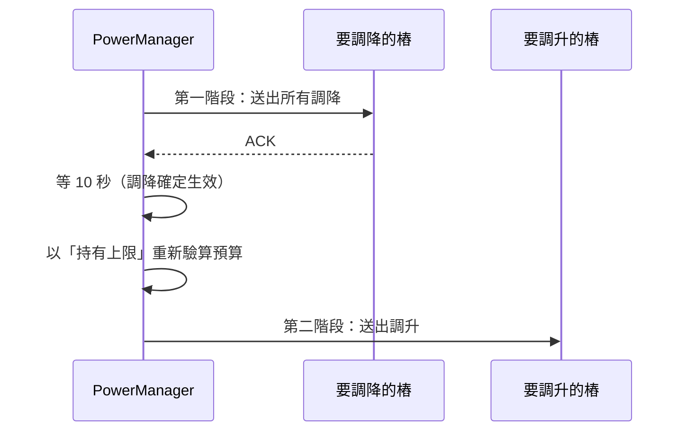

# 第 7 章　核心演算法

本章介紹系統的 8 個演算法，分成兩組：

- **控制**（功率）：注水法分配、排隊與保留、遲滯需求偵測、下達死區、先降後升
- **正確性**（計費）：時段判定、電量分攤、最大餘數法、金額捨入

每個演算法都是 `domain/` 裡的純函數，有對應的單元測試。建議一邊讀一邊打開原始碼。

---

## 7.1 注水法分配（Water-filling）

### 問題

有 *n* 支樁要分 *B* 瓦。每支樁 *i* 有自己的需求上限 *cᵢ*（一般 7 kW；快充滿的車較低），
每支最少 1.4 kW、最多 7 kW。目標：**在不超過 B 的前提下，盡量公平**——
需求低的拿夠就好，省下來的讓需求高的平分。

### 直覺

想像每支樁是一個容器，容器高度是它的需求上限。往所有容器同時倒水，水位一起上升；
矮的容器滿了就停，剩下的水繼續分給高的容器。最後的水位就是「公平份額」。

```text
需求上限：  CP01  CP02  CP03 … CP08
            1.5   1.5   7.0    7.0
水位上升 → CP01、CP02 在 1.5 kW 滿了 → 其餘 6 支繼續上升到 4.5 kW → 總共 30 kW
```

### 演算法

```python
# src/chargeshare/domain/allocation.py
def _water_fill(served, budget, config) -> dict[str, int]:
    caps = sorted(
        ((min(max(c.demand_cap_w, config.min_w), config.max_w), c.charger_id) for c in served),
    )
    limits = {}
    remaining = budget
    for index, (cap, charger_id) in enumerate(caps):
        level = remaining // (len(caps) - index)
        if cap > level:
            # 其餘樁的需求都高於水位：全部拿同一個水位，捨去的零頭不再分配
            shared = _floor_to_step(level, config.step_w)
            limits.update((cid, shared) for _, cid in caps[index:])
            break
        limits[charger_id] = _floor_to_step(cap, config.step_w)
        remaining -= limits[charger_id]
    return limits
```

1. 把需求上限夾在 [1.4, 7] kW 之間，**由小到大排序**。
2. 依序處理：目前的平均水位 = 剩餘預算 ÷ 剩餘支數。
3. 如果這支的需求 ≤ 水位，給它需求量，從預算扣掉。
4. 否則，**它和後面所有的樁**（需求都更高）一起拿這個水位，結束。

### 推演：2 支快充滿

| 步驟 | 樁 | 需求 | 剩餘預算 | 剩餘支數 | 水位 | 結果 |
|---|---|---|---|---|---|---|
| 0 | CP01 | 1,500 | 30,000 | 8 | 3,750 | 需求 ≤ 水位 → 給 1,500 |
| 1 | CP02 | 1,500 | 28,500 | 7 | 4,071 | 需求 ≤ 水位 → 給 1,500 |
| 2 | CP03 | 7,000 | 27,000 | 6 | 4,500 | 需求 > 水位 → CP03–CP08 都給 4,500 |

總和 = 2 × 1,500 + 6 × 4,500 = 30,000 W ✅（驗收 4）

### 為什麼總和一定不超過預算？

- 第 3 步給的量都從 `remaining` 扣掉。
- 第 4 步給每支 `floor(remaining ÷ k)` 再向下取整到 50 W，*k* 支加起來 ≤ `remaining`。

所以總和 ≤ `budget`，而且這是靠**整數除法與向下取整**保證的，不是靠「算完再檢查」。
測試用 2,000 組隨機輸入驗證這個不變量（第 9 章）。

### 一個真實的 bug：零頭要「一次」捨去

最早的版本在每一步都各自向下取整，結果 8 支樁拿到 3,700 / 3,800 / 3,700 / …——
前面的樁捨去的零頭留在 `remaining` 裡，被後面的樁拿走。總和沒有超標，但：

1. 不公平（驗收 3 要求每支 3.75 kW）。
2. 下一次重算時零頭可能落在不同的樁上 → 觸發多餘的調整，破壞防振盪。

修正方式就是第 4 步：先求出共同水位，**一次**捨去，零頭不再分配。（第 10 章案例 1）

### 為什麼級距是 50 W？

級距越小越精確，但太小沒有意義（樁的控制精度有限）。最初選 100 W，結果 3.75 kW 無法表達。
50 W（約 0.2 A）讓 3,750、1,400、4,500 都能整除。**從驗收數字反推參數**是很實用的做法。

複雜度：排序 O(*n* log *n*)，*n* 是供電中的樁數。

---

## 7.2 排隊與離線保留

分配前還有兩步（`allocate()` 的前半段）：

```python
# 1. 離線但有交易的樁可能仍依最後上限供電，額度必須保留
reserved = {c.charger_id: c.held_limit_w for c in chargers
            if not c.online and c.has_session and c.held_limit_w > 0}
budget = max(config.capacity_w - sum(reserved.values()), 0)

# 2. 依先來後到，最多讓 budget / min_w 支樁供電，其餘排隊
active = sorted((c for c in chargers if c.online and c.has_session),
                key=lambda c: (c.arrived_at, c.charger_id))
slots = budget // config.min_w
served, waiting = active[:slots], active[slots:]
```

### 排隊

每支樁至少要 1.4 kW 才能充電，所以最多 `floor(B ÷ 1.4 kW)` 支能同時供電。
22 支同時要充電時：`floor(30,000 ÷ 1,400) = 21` 支，水位 `floor(30,000 ÷ 21) = 1,428` → 取整 1,400 W，
第 22 支排隊（驗收 5）。

依「開始時間」排序，所以：

- 先到的先服務；有人結束時，排隊第一位**自然**在下次重算時補上，不需要特別的「出隊」邏輯。
- 後到的不會搶走已在供電的樁的位置（不搶佔）。
- 排序鍵加上 `charger_id` 當第二鍵，讓同時到達的情況結果**確定**（可重現）。

### 離線保留

離線的樁從斷線那一刻起就保留它的「持有上限」（7.5 節），預算扣掉這部分再分給其他樁。
所以斷線 5 分鐘後，其他樁的上限不會提高（驗收 9）。

---

## 7.3 遲滯需求偵測（防振盪的核心）

### 問題

車快充滿時，實際功率會低於分配值。系統要把用不到的額度轉給別人，但**不能因此來回反覆調整**。

天真的做法：「實際功率 < 上限就把上限降成實際功率」。問題是功率有雜訊：

```text
CP01 實際 980 → 降成 980 → 別人升 → 下一分鐘 CP01 量到 1010（車其實還要）→ 升回去 → 別人降 → …
```

每次調整都會影響其他 7 支樁，系統一直在抖。

### 解法：遲滯（Hysteresis）

就像冷氣的恆溫器：設定 26°C 時，不會在 25.9°C 關、26.1°C 開，而是 25°C 關、27°C 開——
中間有一段「不動作」的區間。

```python
# src/chargeshare/domain/demand.py
if state.mode == DemandMode.HUNGRY:
    if power_w >= limit_w * config.saturate_ratio:       # ≥ 80%：維持 HUNGRY
        return DemandState.initial(config)
    streak = state.low_streak + 1
    if streak < config.streak:                            # 還沒連續 2 筆
        return DemandState(DemandMode.HUNGRY, config.max_w, streak)
    return DemandState(DemandMode.SATURATED, _needed_cap(power_w, config))

if power_w >= min(state.cap_w, limit_w) * config.recover_ratio:   # ≥ 95%：回到 HUNGRY
    return DemandState.initial(config)
needed = _needed_cap(power_w, config)
if needed <= state.cap_w - config.cap_step_w:             # 低了一整個級距才下修
    return DemandState(DemandMode.SATURATED, needed)
return state
```

四層防護：

| 機制 | 擋住什麼 |
|---|---|
| 進入 80%、離開 95% | 在門檻附近來回切換 |
| 連續 2 筆才判定 | 單筆異常讀數 |
| 需求量化為 0.5 kW 級距（實際功率 + 0.5 kW，向上取整） | 小幅波動改變需求值 |
| SATURATED 時需求**只往下調**，且要低一整個級距 | 在級距邊界上跳動 |

### 推演：雜訊在級距邊界

CP01 的功率在 1,000 W 附近 ±20 W 波動，目前需求上限 1,500 W：

| 讀數 | 需要的上限 ⌈(p + 500) / 500⌉ × 500 | 下修條件 needed ≤ 1,500 − 500 | 回升條件 p ≥ 1,500 × 95% | 結果 |
|---|---|---|---|---|
| 980 | 1,500 | 否 | 否 | 不變 |
| 1,020 | **2,000** | 否 | 否 | 不變 |
| 990 | 1,500 | 否 | 否 | 不變 |

沒有遲滯的話，1,020 W 那筆會把需求推到 2,000、990 W 又拉回 1,500，每分鐘重新分配一次。

### 為什麼回升條件用 min(需求, 上限)？

假設 CP01 的需求記錄為 3,000 W，但因為車很多，實際分到的上限只有 1,400 W。
如果車又開始要電，它最多也只能用到 1,400 W，**永遠不會達到 3,000 × 95%**。
用 `min(3000, 1400) × 95% = 1,330 W` 當門檻，車用滿上限時就能正確回到 HUNGRY。
（測試：`test_recovery_uses_limit_when_limit_is_below_cap`）

### 為什麼排隊中的讀數要忽略？

```python
if limit_w <= 0:
    # 排隊中或尚未下達上限，量到的功率不代表車的需求
    return state
```

上限是 0 時量到 0 W，並不代表車不要電。

---

## 7.4 下達死區與非對稱規則

算出新的目標上限後，`plan_dispatch()` 決定哪些真的要送：

```python
for charger_id in current.keys() | target.keys():
    old = current.get(charger_id, 0)
    new = target.get(charger_id, 0)
    if new < old:
        # 調降一律下達：保留舊值可能讓總和超過容量
        decreases[charger_id] = new
    elif new - old >= deadband_w:
        increases[charger_id] = new
```

規則**不對稱**：

- **調升**小於 300 W 不送——少用一點額度只是浪費一點點，換來更少的指令。
- **調降**一律送——不送的話，舊值較高，總和可能超過 30 kW。

> 💡 **教學重點**：判斷一個規則是否可以「放寬」，要看放寬後最壞會發生什麼。
> 少調升 → 最壞是浪費；少調降 → 最壞是跳電。兩者的風險不對稱，規則就該不對稱。

在服務層，還有一層更粗的防振盪：**只有事件觸發重算**（交易開始/結束、上下線、需求狀態改變），
功率的小幅波動根本不會觸發 `allocate()`。

---

## 7.5 先降後升：保證「任何時刻」不超過 30 kW

### 問題

樁收到新上限後最多 10 秒才生效。如果同一次重算有調降也有調升，一起送出：

```text
CP01、CP02：3.75 → 1.5 kW（調降）
CP03–CP08：3.75 → 4.5 kW（調升）

最壞情況：調升已生效、調降還沒生效
= 2 × 3.75 + 6 × 4.5 = 34.5 kW ❌
```

### 解法：兩階段




這張圖是用真正的 `PowerManager` 跑這個情境、記錄實際下達的指令後算出來的
（[`scripts/two_phase_chart.py`](../../scripts/two_phase_chart.py)）。

### 持有上限（held limit）

第二階段之前要再驗算一次，因為第一階段可能失敗（例如樁剛好斷線，調降沒送到）。
驗算用的是每支樁的**持有上限**：

```text
持有上限 = max(樁已確認的上限, 已送出但未確認的上限)
```

這個定義涵蓋所有不確定的情況：

| 情況 | 樁可能在用的值 | 持有上限 |
|---|---|---|
| 調降已送出、未確認 | 舊（高）或新（低） | 舊（高） ✅ |
| 調升已送出、未確認 | 舊（低）或新（高） | 新（高） ✅ |
| 已確認 | 確認值 | 確認值 |

只要「所有樁的持有上限總和 ≤ 30 kW」，不管樁實際在用哪個值，總和都不會超標。

```python
async def _send_increases(self, increases: dict[str, int]) -> None:
    held_total = self.total_held_w()
    approved = {}
    for charger_id, limit in sorted(increases.items()):
        held = self._chargers[charger_id].held_w
        if held_total - held + limit <= self._power.capacity_w:
            approved[charger_id] = limit
            held_total += limit - held
    if len(approved) < len(increases):
        self._retry_later()      # 預算不夠的調升延後重試
    ...
```

### 正確性論證（非正式）

設不變量 *I*：所有樁持有上限的總和 ≤ *C*（30 kW）。

1. **送出調降**：持有上限 = max(舊, 新) = 舊，總和不變，*I* 維持。
2. **調降確認**：持有上限從舊降到新，總和變小，*I* 維持。
3. **送出調升**：送出前檢查「總和 − 該樁持有 + 新值 ≤ *C*」，送出後持有上限 = 新值，*I* 維持。
4. 每支樁的實際上限 ≤ 它的持有上限（由定義）。

所以任何時刻，實際上限總和 ≤ 持有上限總和 ≤ *C*。∎

這個論證有個前提：**樁會在 10 秒內套用新上限，而且依序套用**。這就是為什麼要把它寫進通訊約定，
也是為什麼模擬器「不依序套用」的 bug（第 10 章案例 3）會讓實際功率超過 30 kW。

> 💡 **教學重點**：分散式系統的安全性證明，幾乎都是「找一個不變量，證明每個動作都保持它」。
> 關鍵是不變量要建立在**你能確定的資訊**上（持有上限），而不是你希望的狀態（樁已經套用了）。

---

## 7.6 時段判定

```python
def period_at(self, when: datetime) -> RatePeriod:
    local = when.astimezone(TAIPEI)
    season = self.season_on(local.date())
    if self.is_offpeak_day(local.date()):          # 週末、國定假日
        return RatePeriod(season, Band.OFFPEAK)
    minute = local.hour * 60 + local.minute
    band = Band.PEAK if self.rule(season).is_peak_minute(minute) else Band.OFFPEAK
    return RatePeriod(season, band)
```

設計重點：

- 先轉成台灣時間（樁可能送 UTC）。
- 尖峰區間用「當日第幾分鐘」的半開區間 `[start, end)` 表示，`24:00` = 1440，邊界不重疊。
- 費率、季節、尖峰時段全部來自 [`config/tariff.toml`](../../config/tariff.toml)，改費率不用改程式。
- 沒有該年度假日資料時直接拋錯（fail fast），而不是默默當成「沒有假日」。

### next_change：下一個可能變價的時間點

分攤演算法需要知道「從現在起，時段最早什麼時候會改變」：

```python
def next_change(self, when: datetime) -> datetime:
    local = when.astimezone(TAIPEI)
    midnight = local.replace(hour=0, minute=0, second=0, microsecond=0)
    elapsed = local - midnight
    for boundary in self.rule(self.season_on(local.date())).boundaries():
        if timedelta(minutes=boundary) > elapsed:
            return midnight + timedelta(minutes=boundary)
```

非夏月的邊界是 06:00、11:00、14:00、24:00。注意它回傳的是「**可能**改變」：
週末時 06:00 其實不會變價，但多切一刀只是把同一個時段分成兩段，不影響結果。
**寧可多切、不可少切**，讓演算法保持簡單。

---

## 7.7 電量分攤

### 問題

讀數每分鐘一筆，但斷線或重開機會造成缺口，例如只有 08:30 與 09:30 兩筆，中間跨過 09:00 的尖峰起點。
這 1 小時的電量要怎麼分給離峰與尖峰？

### 解法：依時間線性分攤

假設兩筆讀數之間功率均勻（沒有更多資訊時最合理的假設），電量依時間比例分配：

```python
for prev, cur in zip(ordered, ordered[1:]):
    delta_wh = segment_energy(prev, cur)            # 這段的電量（含電表重置處理）
    span = (cur.ts - prev.ts) // MICROSECOND
    t = prev.ts
    while t < cur.ts:
        nxt = min(tariff.next_change(t), cur.ts)    # 切到下一個可能變價的點
        exact[tariff.period_at(t)] += Fraction(delta_wh * ((nxt - t) // MICROSECOND), span)
        t = nxt
```

推演：08:30 → 09:30，電表增加 7,000 Wh（夏月平日）

| 區段 | 時段 | 佔比 | 電量 |
|---|---|---|---|
| 08:30–09:00 | 夏月離峰 | 30/60 | 3,500 Wh |
| 09:00–09:30 | 夏月尖峰 | 30/60 | 3,500 Wh |

正常情況下讀數每分鐘一筆、時段邊界在整點，所以每段都只落在一個時段裡，切割不會發生；
但演算法對有缺口與沒缺口的情況**一視同仁**，不需要特例。

### 為什麼用 Fraction？

7,000 Wh 分 3 等份是 2,333.33…，用浮點數會累積誤差。`Fraction` 是精確的有理數，
整個計算過程不損失精度，最後才一次轉成整數（下一節）。時間用微秒整數相除，也避免浮點。

---

## 7.8 最大餘數法：讓「尖峰 + 離峰」恰好等於電表差值

### 問題

題目要求各時段度數計算到 0.001 度（= 1 Wh）。各自四捨五入會讓總和對不上：

```text
3 Wh 平分到兩個時段：1.5 + 1.5
各自四捨五入：2 + 2 = 4 Wh ≠ 3 Wh ❌
```

驗收 10、13 要比對「模擬器送出的電量」與「伺服器計費的尖峰 + 離峰」，差 1 Wh 就不一致。

### 解法：最大餘數法（Largest Remainder Method）

這是國會席次分配常用的方法：

1. 每個時段先**無條件捨去**。
2. 算出總和還差幾個單位（`leftover`）。
3. 依小數部分**由大到小**，各補 1 個單位，直到補完。

```python
def _round_preserving_total(exact: dict[RatePeriod, Fraction]) -> dict[RatePeriod, int]:
    floors = {period: int(value) for period, value in exact.items()}
    leftover = int(sum(exact.values())) - sum(floors.values())
    by_remainder = sorted(exact, key=lambda p: exact[p] - floors[p], reverse=True)
    for period in by_remainder[:leftover]:
        floors[period] += 1
    return {period: wh for period, wh in floors.items() if wh > 0}
```

`3 Wh = 1.5 + 1.5` → 捨去得 1 + 1 → 差 1 → 補給其中一個 → 2 + 1 = 3 ✅

性質：每個時段與精確值的差 < 1 Wh，而且總和**恰好**等於精確總和（電表差值永遠是整數）。

---

## 7.9 金額與捨入

```python
def price(split, tariff) -> Charge:
    energy_amount = sum((Decimal(wh) / WH_PER_KWH * tariff.rate(period)
                         for period, wh in split.items()), Decimal(0))
    ...

def bill_total(amounts: Iterable[Decimal]) -> int:
    total = sum(amounts, Decimal(0))
    return int(total.quantize(Decimal(1), rounding=ROUND_HALF_UP))
```

每筆交易保留精確金額，**帳單總額才四捨五入**。為什麼？

| 情境 | 每筆先捨入 | 總額才捨入 |
|---|---|---|
| 3 筆各 10.4 元 | 10 + 10 + 10 = 30 | 31.2 → **31** |

每筆先捨入，誤差會隨筆數累積；總額才捨入，誤差最多 0.5 元。

另一個細節：Python 內建的 `round()` 是「銀行家捨入」（`round(2.5) == 2`），
台灣一般的「四捨五入」要明確指定 `ROUND_HALF_UP`。

### 手算驗證（驗收 11）

| 充電 | 計算 | 金額 |
|---|---|---|
| 10/23（五）23:00 → 10/24（六）07:00，7 kW | 7 × 4.8 + 49 × 1.9 + 56 × 0.5 | 154.70 |
| 10/22（四）10:00 → 12:00，3.5 kW | 3.5 × 4.8 + 3.5 × 1.9 + 7 × 0.5 | 26.95 |
| **帳單** | 181.65 | **182 元** |

---

## 7.10 日曆月加法

「開立後超過 2 個月」需要「日期加 2 個月」。月份長度不同，要把日期夾在月底：

```python
def add_months(day: date, months: int) -> date:
    month_index = day.month - 1 + months
    year, month = day.year + month_index // 12, month_index % 12 + 1
    return date(year, month, min(day.day, calendar.monthrange(year, month)[1]))
```

`12/31 + 2 個月 = 2/28`（不是 3/3）。這種小函數最容易在邊界出錯，所以測試直接列出月底的案例。

---

## 小結

| 演算法 | 核心想法 | 保證 |
|---|---|---|
| 注水法 | 需求低的拿夠，其餘平分；一次捨去 | 總和 ≤ 預算、公平 |
| 排隊 | 依開始時間、最多 ⌊B/1.4⌋ 支 | 先到先服務、不搶佔 |
| 遲滯 | 進出門檻不同、連續 N 筆、量化、只下修 | 雜訊不觸發調整 |
| 死區 | 調升小於 300 W 不送、調降一律送 | 少指令且安全 |
| 先降後升 | 不變量：持有上限總和 ≤ C | 任何時刻 ≤ 30 kW |
| 時段分攤 | 依時間線性分攤，在可能變價處切割 | 跨時段、跨季節正確 |
| 最大餘數法 | 先捨去，再依餘數補 | 總和精確 |
| 金額捨入 | 總額才捨入、ROUND_HALF_UP | 誤差最小 |

## 思考題

1. 注水法給「需求低的樁」剛好它要的量。如果改成「依電池剩餘電量加權分配」（快沒電的多拿），演算法要怎麼改？還能保證總和 ≤ 預算嗎？
2. 把遲滯的 80% / 95% 改成 90% / 92%，在什麼情況下會開始振盪？寫一個測試證明你的猜測。
3. 先降後升要等 10 秒。如果樁會回報「已套用」，可以怎麼縮短等待？論證的哪一步需要修改？
4. 最大餘數法在兩個時段的小數部分剛好相等時，補給哪一個？結果是否確定（可重現）？
