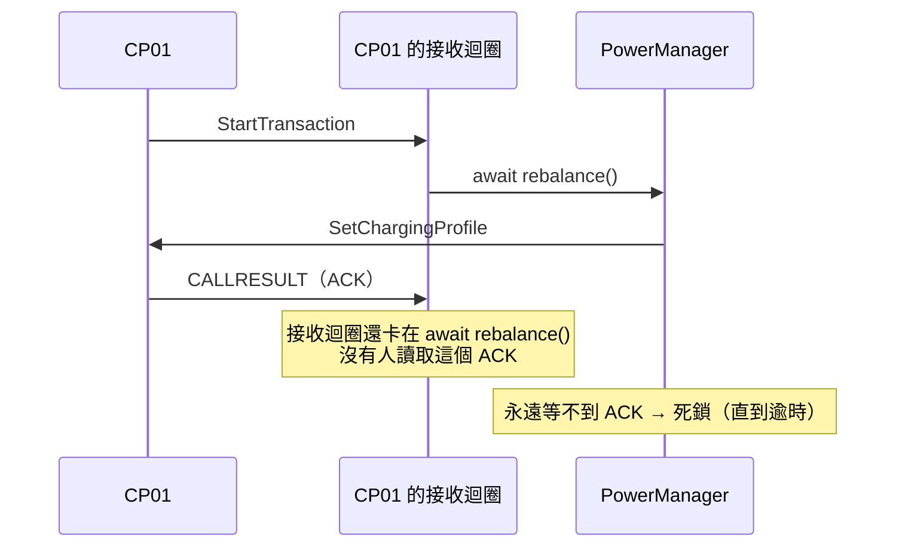

# 第 8 章　時間與並行

## 學習目標

- 設計可注入的時鐘，並理解三種實作的用途
- 寫出可以「精確控制時間」的測試
- 用單一 worker 加「髒旗標」串行化重算，並合併多餘的請求
- 辨認並避免 asyncio 中的死鎖與未讀取的例外

---

## 8.1 為什麼時間要注入？

如果程式直接呼叫 `datetime.now()` 和 `asyncio.sleep(10)`：

- 測「斷線 5 分鐘後」要真的等 5 分鐘。
- 測「每月 1 日產生帳單」要等到下個月 1 日。
- 測「5/31 22:00 跨到 6/1」只能改電腦時間。
- 模擬器跑 30 分鐘就是 30 分鐘。

把時間變成參數，以上全部變成幾毫秒的事。

```python
# src/chargeshare/clock.py
class Clock(Protocol):
    def now(self) -> datetime: ...
    async def sleep(self, seconds: float) -> None: ...
```

系統裡**所有**「現在幾點」與「等待」都經過這個介面，包括網路呼叫的逾時。

---

## 8.2 三種時鐘

| 實作 | 用途 | `now()` | `sleep(s)` |
|---|---|---|---|
| `SystemClock` | 正式執行 | 真實時間 | 真的等 *s* 秒 |
| `FakeClock` | 單元與整合測試 | 只在呼叫 `advance()` 時前進 | 掛起，直到 `advance()` 推過截止時間 |
| `ScaledClock` | 加速模擬、端對端測試 | 起點 + 經過時間 × 倍速 | 等 *s* ÷ 倍速 秒 |

### FakeClock：讓時間「逐格前進」

```python
async def advance(self, seconds: float) -> None:
    """逐一喚醒截止時間落在範圍內的 sleeper，讓它們依時間順序執行。"""
    target = self._now + timedelta(seconds=seconds)
    await _let_tasks_run()
    while self._sleepers and self._sleepers[0][0] <= target:
        deadline, _, future = heapq.heappop(self._sleepers)
        self._now = deadline                 # 時間跳到這個 sleeper 的截止點
        if not future.done():
            future.set_result(None)
        await _let_tasks_run()               # 讓被喚醒的 task 執行到下一個 await
    self._now = target
    await _let_tasks_run()
```

關鍵設計：

1. **用 heap 依截止時間排序**，被喚醒的順序與真實世界一致。
2. **時間跳到每個截止點**，而不是直接跳到終點。被喚醒的 task 讀 `now()` 時，看到的是「它本來應該醒來的時間」。
3. **喚醒後讓出 event loop**，讓 task 有機會執行，甚至排下一個 sleep——如果新的截止時間仍在範圍內，同一次 `advance()` 也會喚醒它。

第 3 點讓「先降、等 10 秒、再升」可以這樣測：

```python
await clock.advance(30)
# 這 30 秒內：送出調降 → sleep(10) 被喚醒 → 送出調升，全部依序發生，時間戳都正確
```

### ScaledClock：用 monotonic 而非牆上時鐘

```python
def now(self) -> datetime:
    elapsed = (time.monotonic() - self._origin) * self._speed
    return self._start + timedelta(seconds=elapsed)
```

`time.monotonic()` 不受系統校時（NTP）影響。如果用 `time.time()`，校時的瞬間模擬時間可能倒退。

---

## 8.3 加速模擬：讓兩邊共用同一個時鐘

端對端測試在**同一個 event loop** 裡啟動伺服器與 8 支模擬樁，傳入同一個 `ScaledClock(speed=120)`：

```python
clock = ScaledClock(SIM_START, speed=SPEED)
app = create_app(Settings(database_url=url, dev_mode=True), clock)
async with serving(app) as port:                       # uvicorn 在同一個 loop 內
    result = await run_fleet(options, f"ws://127.0.0.1:{port}/ocpp", clock, minutes)
```

如果伺服器與模擬器在不同行程、各自加速，兩邊的時間會漂移：伺服器的「等 10 秒」對模擬器來說可能是 9 秒或 11 秒，
測試結果就不穩定。共用時鐘讓兩邊對「現在」的認知完全一致。

### 加速的代價

120 倍速下，真實的 1 秒 = 模擬的 2 分鐘。event loop 只要延遲 0.5 秒，模擬時間就跳了 1 分鐘。
這在 CI 這種較慢的機器上會暴露時序假設（第 10 章案例 9）。教訓是：**模擬的情境應該以事件為錨點**
（例如「開始充電後第 5 分鐘重開機」），而不是以絕對時間為錨點（「模擬開始後第 5 分鐘」）。

---

## 8.4 單一 worker 與髒旗標

事件可能在很短時間內大量湧入（8 支樁同時開始充電）。如果每個事件都觸發一次完整的重算與下達，
不只浪費，還會讓多個重算**同時**在跑，互相覆蓋。

`PowerManager` 用最簡單的串行化方式：

```python
def _kick(self) -> None:
    self._dirty = True
    if self.idle:
        self._worker = asyncio.get_running_loop().create_task(self._run())

async def _run(self) -> None:
    while self._dirty:
        self._dirty = False
        try:
            await self._rebalance()
        except Exception:
            logger.exception("rebalance failed")
            self._retry_later()
```

運作方式：

```text
事件 A → dirty = True，啟動 worker
事件 B → dirty = True（worker 已在跑，不另外啟動）
事件 C → dirty = True
worker：dirty = False → 重算（看到 A、B、C 的結果）→ 檢查 dirty
        → 重算途中又有事件 D 進來 → dirty = True → 再算一次
        → dirty = False → 結束
```

三個性質：

1. **同一時間只有一個重算**（只有一個 worker task）。
2. **不會漏掉事件**：重算途中進來的事件會把 dirty 設回 True，迴圈會再跑一次。
3. **自動合併**：A、B、C 三個事件只觸發一次重算。

這比用 `asyncio.Lock` 更好：Lock 會讓三個事件排隊各算一次，而這裡只算需要的次數。

> 💡 **教學重點**：「髒旗標 + 單一 worker」是處理「狀態改變後需要重新計算」的通用模式，
> 在 UI 重繪、快取更新、搜尋索引都看得到。

---

## 8.5 死鎖預防

考慮這個看似合理的寫法：

```python
# ❌ 錯誤示範
def _start_transaction(self, ctx, req):
    tx = create_transaction(...)
    await power_manager.rebalance()      # 等分配完成、指令送出、收到 ACK
    return {"transactionId": tx.id}
```

問題：



接收迴圈正在等 `rebalance()`，而 `rebalance()` 在等接收迴圈讀進來的 ACK。

正確做法是**發布事件、立即返回**，讓 PowerManager 在自己的 task 裡做事：

```python
# src/chargeshare/ocpp/router.py
if created:
    ctx.events.append(SessionStarted(ctx.charger.id, tx.id, tx.start_ts))
return {"transactionId": tx.id, "idTagInfo": {"status": "Accepted"}}
# commit 後：self._events.publish(event) → PowerManager._kick() → create_task
```

> 💡 **教學重點**：在 asyncio 裡，「我在處理 X 的回應時，等待一個需要 X 才能完成的東西」是最常見的死鎖。
> 規則：**I/O 迴圈裡只做短的、不等待外部的工作**；需要等待的事交給另一個 task。

---

## 8.6 背景任務

伺服器啟動時建立三個週期性任務，都使用注入的時鐘：

```python
tasks = [
    asyncio.create_task(_every(clock, settings.snapshot_interval_s, snapshot, "snapshot")),
    asyncio.create_task(_every(clock, 3600, monthly_bills, "monthly_bills")),
    asyncio.create_task(_every(clock, settings.heartbeat_interval_s,
                               lambda: ctx.connections.close_stale(heartbeat_timeout), "watchdog")),
]
```

`_every` 裡用 `try/except` 包住每次執行並記錄 `logger.exception`：一次失敗不應該讓整個背景任務停掉，
但也**不能默默吞掉**——錯誤一定要留下紀錄。關閉時取消所有任務並等待它們結束。

---

## 8.7 未讀取的例外

asyncio 的 `Future` 如果被設了例外、卻從來沒有人讀取，被回收時會記錄 ERROR：

```text
Future exception was never retrieved
future: <Future finished exception=ConnectionError('disconnected')>
```

本專案在 CI 上遇到過（第 10 章案例 8）：

1. 送出前在 `pending[id]` 登記 Future。
2. `send()` 時連線剛好中斷 → 走 `send()` 的例外分支。
3. 同時，連線關閉流程把 `pending` 裡的 Future 都設成例外。
4. 沒人讀取那個 Future。

修正方式是「**誰登記、誰清理**」：

```python
finally:
    timer.cancel()
    self._pending.pop(message_id, None)
    # 送出失敗時 mark_closed 可能已設下例外；在此讀取，避免 asyncio 記錄未讀取的例外
    if future.done() and not future.cancelled():
        future.exception()
```

---

## 8.8 同步資料庫在 async 程式裡

本專案在 event loop 裡直接執行同步的 SQLAlchemy 操作（第 4 章的取捨）。要注意：

- 每次操作都很短（本機 SQLite、單筆查詢），才不會卡住其他連線。
- **不要在資料庫交易內 await**：交易會一直持有，其他操作可能被鎖。router 的交易在發布事件之前就結束了。
- 負載變大時的升級路徑：改用 `asyncio.to_thread` 包住資料庫操作，或改用 async driver。

---

## 小結

1. 時間是依賴，要注入；三種時鐘各有用途。
2. FakeClock 逐一跳到截止點，讓時序可以精確測試。
3. 模擬情境以事件為錨點，不要以絕對時間為錨點。
4. 髒旗標 + 單一 worker：串行、不漏、自動合併。
5. I/O 迴圈裡不等待外部；誰登記的 Future 誰清理。

## 思考題

1. 如果 `_rebalance()` 執行到一半拋出例外，`_dirty` 的狀態是什麼？會不會漏掉事件？
2. `FakeClock.advance()` 裡的 `_let_tasks_run()` 讓出 5 次 event loop。如果某個 task 需要讓出 6 次才會走到下一個 `sleep`，會發生什麼？如何讓 FakeClock 更穩健？
3. 設計一個測試，證明「8 個 `SessionStarted` 事件同時發生時，只觸發一次重算」。
